# Zork I, II and III for Browsers

**The Caldwell Z-Machine for Browsers Edition** of Infocom's classic text adventures *Zork I: The Great Underground Empire*, *Zork II: The Wizard of Frobozz* and *Zork III: The Dungeon Master*.

Each game is a single HTML file. Open it in any modern browser and play, with nothing to install, no internet connection needed and no account. The original Infocom game files run unchanged inside a Z-machine interpreter written for this edition, with the look of an early-1980s PC screen.

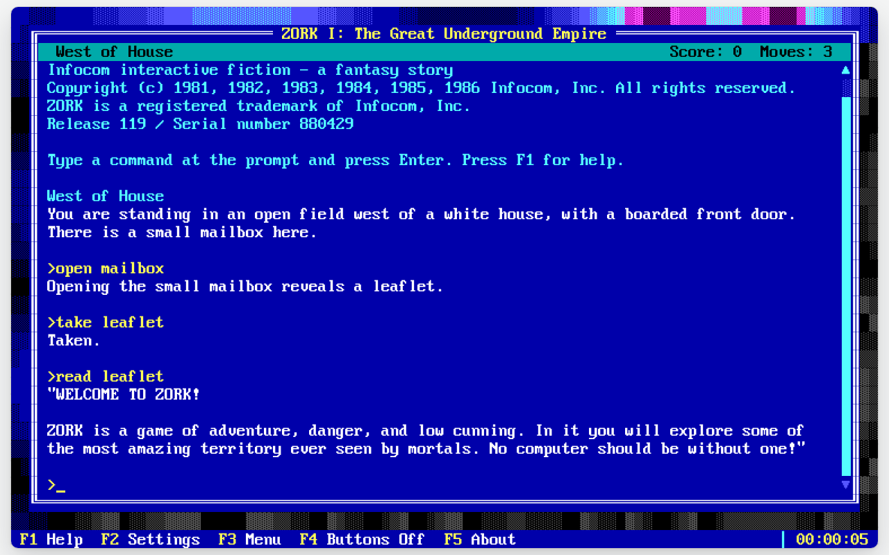

**[Play online](https://jgitman.github.io/Zork/)** · [Play Zork I](https://jgitman.github.io/Zork/zork-i/zork-i-game.html) · [Play Zork II](https://jgitman.github.io/Zork/zork-ii/zork-ii-game.html) · [Play Zork III](https://jgitman.github.io/Zork/zork-iii/zork-iii-game.html)

---

## Contents

- [Playing](#playing)
- [What's in each folder](#whats-in-each-folder)
- [Features](#features)
- [Screenshots](#screenshots)
- [Maps and reference cards](#maps-and-reference-cards)
- [License and credits](#license-and-credits)

## Playing

**Online:** open the [game page](https://jgitman.github.io/Zork/) and pick a game.

**On your own computer:** download this repository (the green **Code** button, then **Download ZIP**), unzip it, and double-click a game file such as `zork-i/zork-i-game.html`. It runs in your browser, works offline, and remembers your place between visits.

Type commands at the `>` prompt and press Enter, just as players did in 1980:

```
>open mailbox
Opening the small mailbox reveals a leaflet.

>take leaflet
Taken.
```

Press **F1** at any time for help. Each game's manual explains everything Zork understands.

## What's in each folder

| File | What it is |
|---|---|
| `zork-i-game.html` | The game. One self-contained file. |
| `zork-i-manual.html` | The full manual: Infocom's original manual, this edition's guide, and the plain-English appendix. Opens from the game's Help screen (F1). |
| `zork-i-manual.md` | The same manual as plain Markdown. |
| `zork-i-reference-card.pdf` | A one-page reference card to print. |
| `zork-i-explorers-map.pdf` | An illustrated map with the secrets left out, for a first playthrough. |
| `zork-i-full-map.pdf` | The complete map: every room, passage, item and treasure. **Contains spoilers.** |

Zork II and Zork III have the same set in `zork-ii/` and `zork-iii/`. `enhanced-language-list.txt` lists the plain-English phrases the games understand.

## Features

Everything is optional. With the extras switched off, each game plays exactly as Infocom wrote it.

- **The original games.** Infocom's own story files run unchanged: Zork I release 119, Zork II release 63 and Zork III release 25.
- **A classic screen.** An IBM VGA text-mode look with a blue or black screen and an animated border. You can switch the border off.
- **Function keys.** F1 Help, F2 Settings, F3 Menu, F4 Command buttons, F5 About.
- **Save and restore.** SAVE and RESTORE work as in the original, and your game is also kept automatically when you close the page.
- **Undo.** Take back a move, or many.
- **Transcripts.** SCRIPT records your game to a text file, as the original did on a printer.
- **A map.** It fills in as you explore, and shows where every exit leads. You can turn it off.
- **Hints.** These are off until you turn them on. They are written for this edition and go from a gentle nudge to the full answer.
- **Command buttons.** Optional buttons for the moves and actions that make sense where you are. They're handy on a phone or tablet.
- **Plain English.** The Enhanced Language setting lets you type everyday questions such as `WHERE AM I?`, `WHICH WAY CAN I GO?`, `GO TO THE KITCHEN` or `WHERE IS THE LAMP?`. Zork always gets the first try, so the original parser is never overruled.
- **Works anywhere.** Runs in any modern browser on a desktop, laptop, tablet or phone.

## Screenshots

| | |
|---|---|
| <br>Blue screen, animated border | 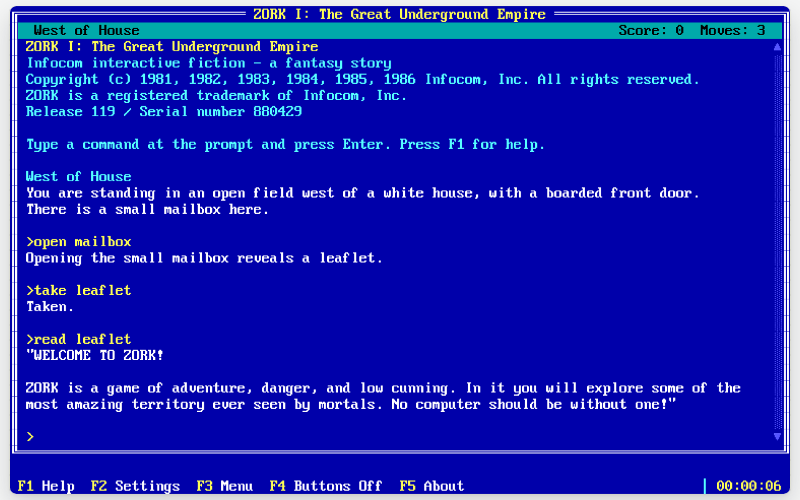<br>Blue screen, no border |
| 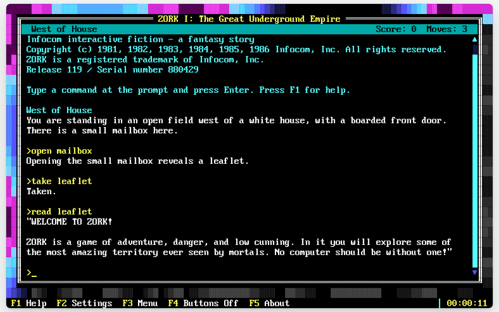<br>Black screen, animated border | 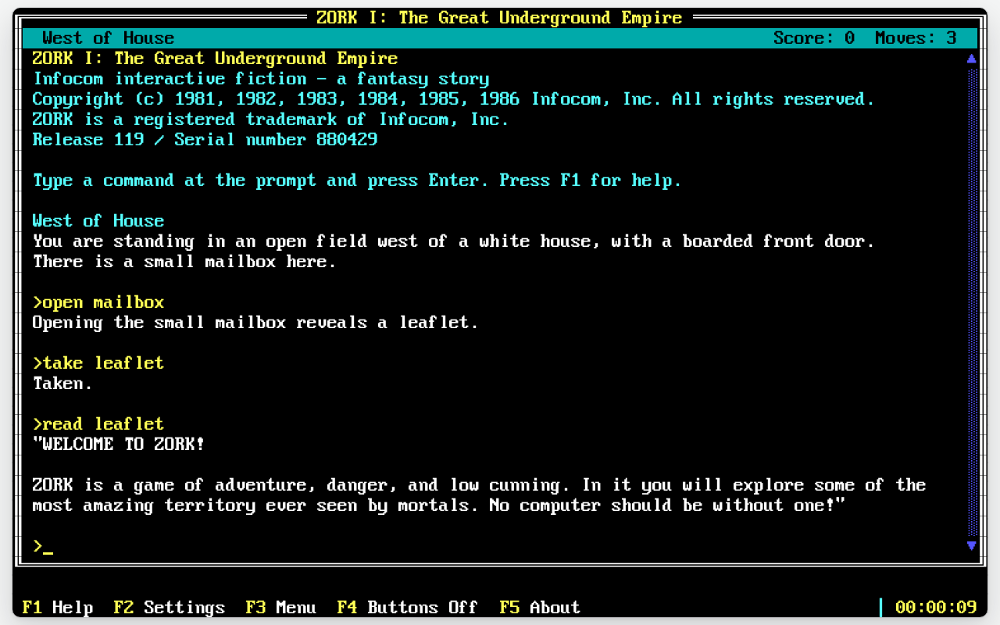<br>Black screen, no border |
| 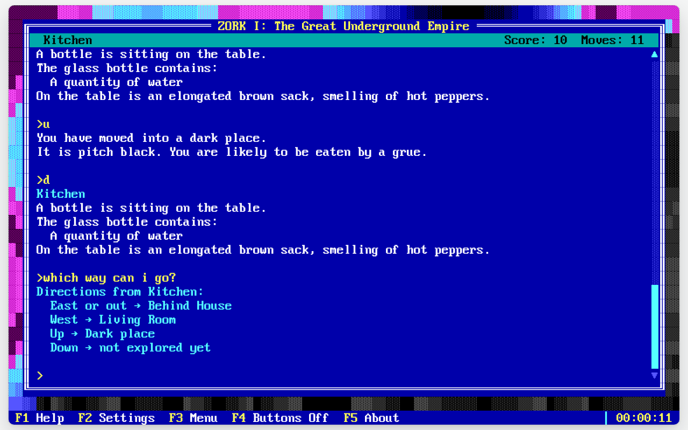<br>Asking in plain English | 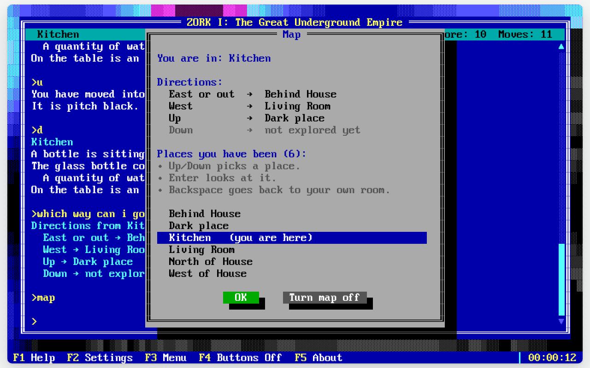<br>The in-game map |
| 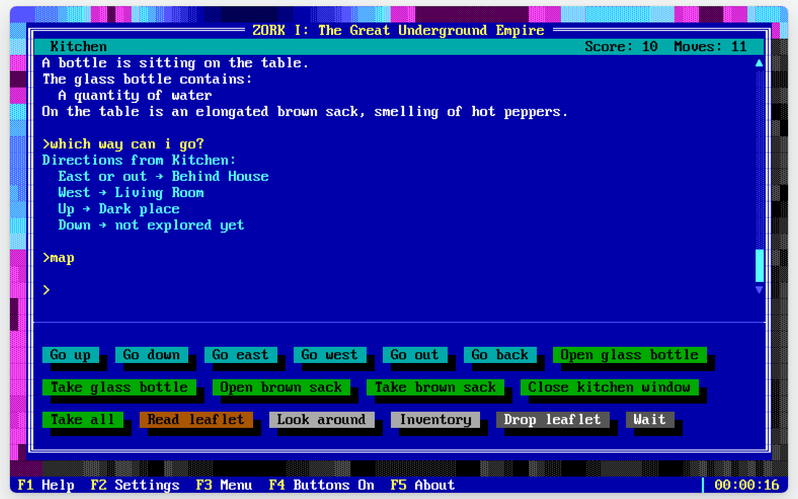<br>Command buttons | 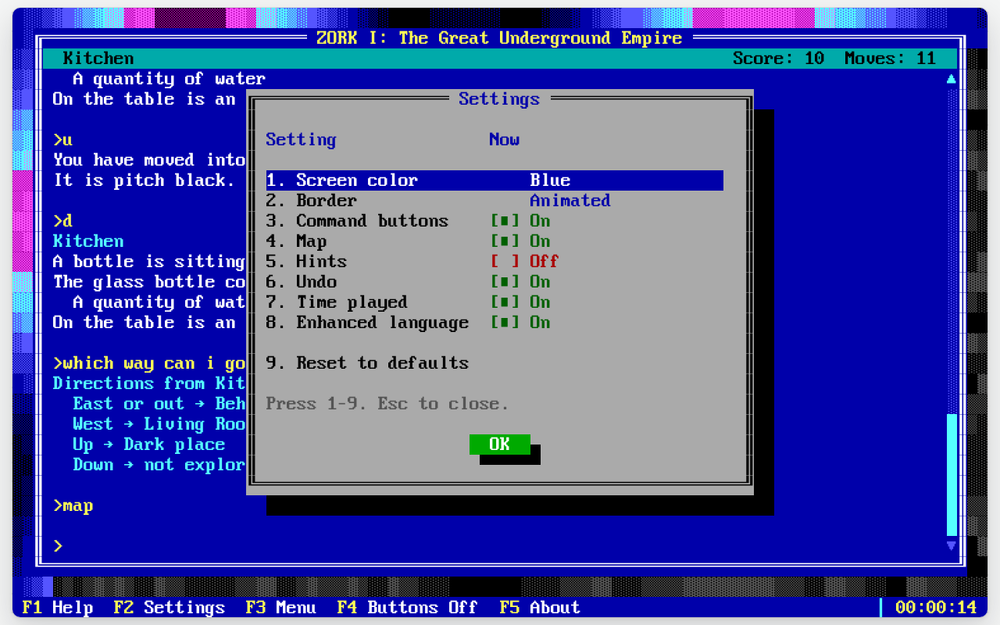<br>Settings (F2) |
| 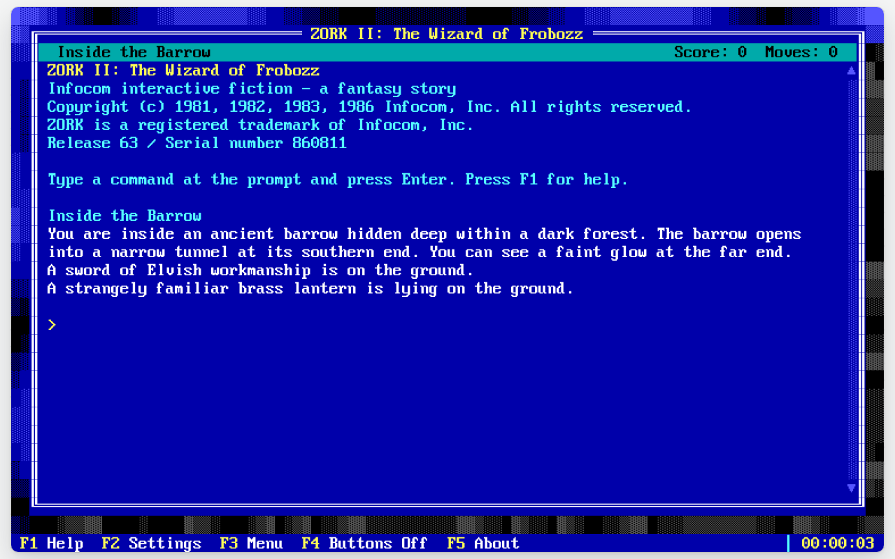<br>Zork II: The Wizard of Frobozz | 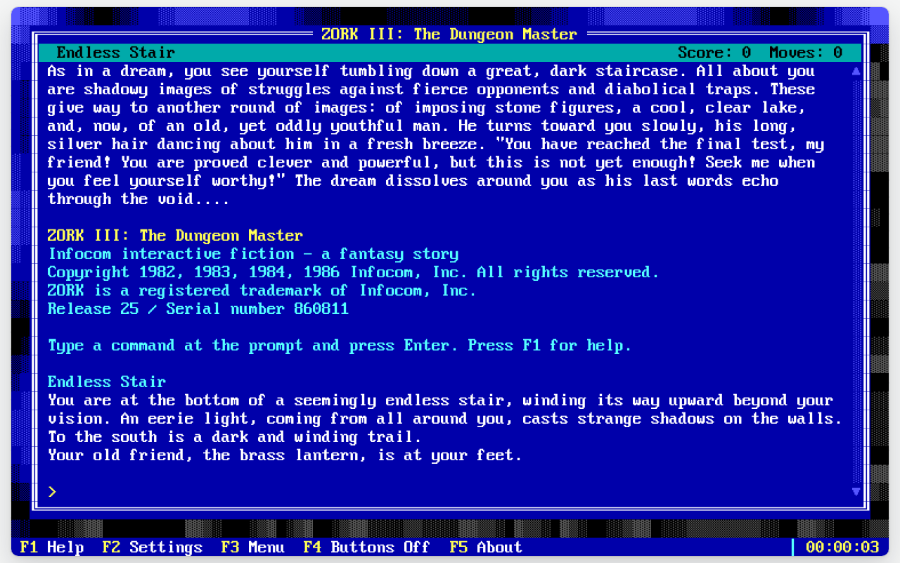<br>Zork III: The Dungeon Master |

## Maps and reference cards

Each game has two illustrated maps drawn in the style of an old parchment chart. They're drawn from the game files themselves, so every room and every exit matches the game.

- **Explorer's Map:** the lands and passages, with treasures, secret routes and puzzle solutions left out.
- **Full Map:** everything, including what each blocked passage needs. It has spoilers.

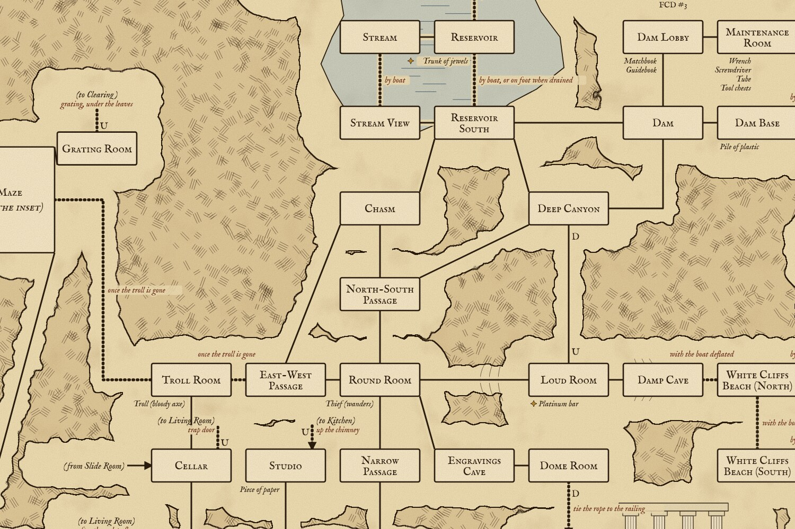

The reference cards are one printable page each. They list Zork's own commands, this edition's keys and settings, a few plain-English examples, and spoiler-free tips for that game.

| Explorer's Map | Reference card |
|---|---|
| 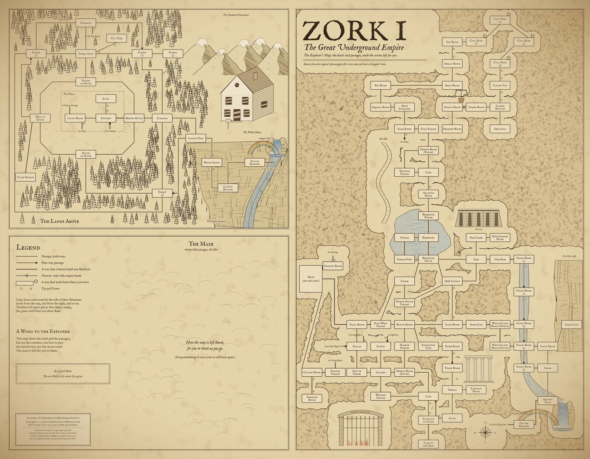 | 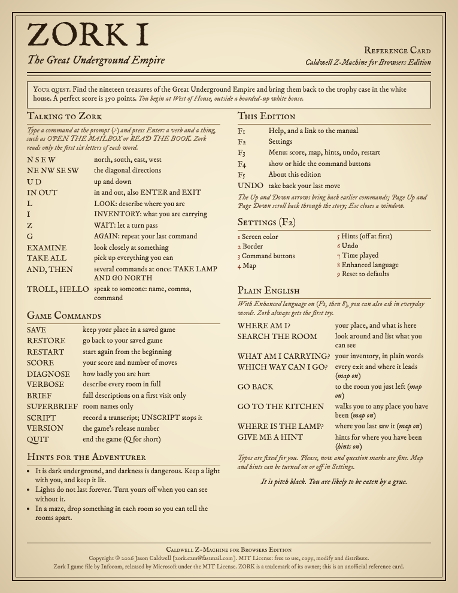 |

## License and credits

**This edition** (the interpreter, interface, maps, reference cards, hints and plain-English layer) is Copyright © 2026 Jason Caldwell, released under the [MIT License](LICENSE). Contact: zork.czm@fastmail.com

**Zork I** was written by Tim Anderson, Marc Blank, Bruce Daniels and Dave Lebling, and **Zork II** and **Zork III** by Marc Blank and Dave Lebling, all of Infocom. The game source code is Copyright © 2025 Microsoft, released under the MIT License. See [THIRD-PARTY-NOTICES.md](THIRD-PARTY-NOTICES.md).

ZORK is a trademark of its owner. This is an unofficial fan edition and is not endorsed by Microsoft, Activision or Infocom.
